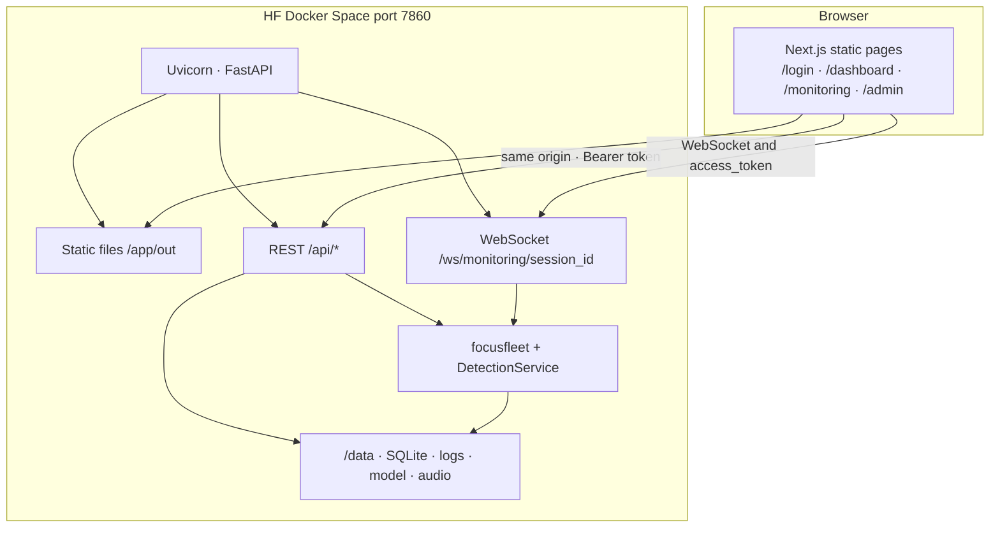
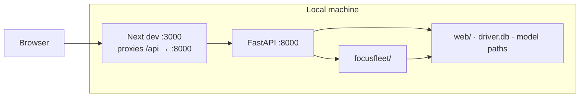
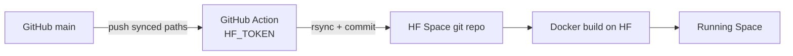

# FocusFleet

Driver drowsiness detection for fleets and demos: **MediaPipe** landmarks, EAR/yawn heuristics, optional **Keras** classifier, session logs, and a **Next.js + FastAPI** web app.

**Live demo (Docker Space):** [huggingface.co/spaces/ArnavPoswal15/FocusFleet](https://huggingface.co/spaces/ArnavPoswal15/FocusFleet)

Architecture details: [docs/ARCHITECTURE.md](docs/ARCHITECTURE.md) · Docker / Space env: [web/README-DOCKER.md](web/README-DOCKER.md)

---

## Architecture (at a glance)

**Live Space (one container, port 7860):**

```
                    ┌─────────────────────────────────┐
                    │           Browser               │
                    │  login · dashboard · monitoring │
                    │  analytics · admin (/admin)     │
                    └───────────────┬─────────────────┘
                                    │ same URL (HTTPS)
                                    ▼
┌───────────────────────────────────────────────────────────────────┐
│              Hugging Face Docker Space (:7860)                     │
│  ┌─────────────────────┐      ┌─────────────────────────────┐   │
│  │ Next.js static UI   │      │ FastAPI (Uvicorn)            │   │
│  │ served from /app/out│◄────►│ /api/auth · sessions · admin │   │
│  └─────────────────────┘      │ /ws/monitoring/{session}     │   │
│                                └──────────────┬───────────────┘   │
│                                               ▼                   │
│                                ┌─────────────────────────────┐   │
│                                │ focusfleet (CV + logging)    │   │
│                                │ MediaPipe · EAR · yawn · ML  │   │
│                                └──────────────┬───────────────┘   │
│                                               ▼                   │
│                                /data  SQLite · logs · model · mp3  │
└───────────────────────────────────────────────────────────────────┘
         ▲
         │  git push main  ──►  GitHub Action (HF_TOKEN)  ──►  sync + rebuild
    GitHub repo
```

**Local dev:** `frontend :3000` ──proxy `/api`──► `backend :8000` ──► `focusfleet/` + `web/` data.

Full diagrams (monitoring sequence, detection pipeline): **[docs/ARCHITECTURE.md](docs/ARCHITECTURE.md)**.

---

## Architecture (Mermaid)

Renders on GitHub and in Mermaid-aware editors. Plain-text diagrams stay in the section above and in [docs/ARCHITECTURE.md](docs/ARCHITECTURE.md#diagrams-for-reading-plain-text).

### Production (Hugging Face Space)



### Local development



### GitHub → Hugging Face sync



More diagrams: [live monitoring sequence](docs/ARCHITECTURE.md#4-live-monitoring-product-path) · [detection pipeline](docs/ARCHITECTURE.md#5-detection-pipeline-shared) · [full architecture](docs/ARCHITECTURE.md).

---

## What’s in this repo

| Part | Folder | Purpose |
| --- | --- | --- |
| Web UI | `frontend/` | Next.js (static export): login, dashboard, monitoring, analytics, admin |
| API | `backend/` | FastAPI: auth, sessions, analytics, WebSocket monitoring |
| CV core | `focusfleet/` | Detection, state machine, shared config |
| HF deploy | `Dockerfile`, `docker-entrypoint.sh`, `runtime-assets/` | Single container on port **7860** |
| Local Gradio | `web/` | Optional CV/UI testing (`web/main.py`) |
| Legacy desktop | `application/` | CustomTkinter (older copy) |

**Flow:** Browser → Next UI → `/api/*` and `/ws/monitoring/{session_id}` → `focusfleet` detection.

---

## Deploy to Hugging Face (GitHub → Space)

### One-time setup

1. **GitHub:** Settings → Secrets → Actions → add **`HF_TOKEN`** (Hugging Face [write token](https://huggingface.co/settings/tokens)).
2. **Space:** Settings → Secrets → add:
   - **`FOCUSFLEET_SECRET_KEY`** — long random string (keeps logins valid after restarts)
   - **`FOCUSFLEET_ADMIN_USERNAME`** — admin login name
   - **`FOCUSFLEET_ADMIN_PASSWORD`** — admin login password  
   Secret names must match **exactly**.
3. Optional: put large files in the Space repo under **`runtime-assets/`** (Git LFS): `driver_drowsiness_model.keras`, alert `.mp3`.

### Every release

```bash
git add -A && git commit -m "feat: …" && git push origin main
```

- GitHub Action **Sync to Hugging Face Space** runs on pushes that touch `focusfleet/`, `backend/`, `frontend/`, `Dockerfile`, etc.
- Or run locally: `./scripts/sync-huggingface-space.sh`
- On Hugging Face, wait for **Building** → **Running**. Use **Factory rebuild** after secret changes.

### After deploy

1. Open the Space URL → **`/login/`** (home redirects to login).
2. **Drivers:** Register → dashboard / monitoring.
3. **Admins:** Sign in with Space secrets → **`/admin/`** (fleet overview, drivers, logs).
4. In **Logs**, look for: `[FocusFleet] Admin account ready for login: '…'`

You do **not** configure separate frontend/backend URLs on the Space: one URL serves UI + API. Auth uses a **Bearer token** in the browser (cookies are unreliable inside HF’s iframe).

More env vars: [web/README-DOCKER.md](web/README-DOCKER.md).

---

## Run locally (full stack)

Python **3.10+** recommended. Use **three terminals** from the repo root.

### 1. Backend

```bash
cd backend
python -m venv .venv && source .venv/bin/activate
pip install -r requirements.txt
export FOCUSFLEET_ADMIN_USERNAME=admin
export FOCUSFLEET_ADMIN_PASSWORD='your-local-password'
uvicorn app.main:app --reload --host 127.0.0.1 --port 8000
```

Check: [http://127.0.0.1:8000/api/health](http://127.0.0.1:8000/api/health)

### 2. Frontend

Create `frontend/.env.local`:

```env
NEXT_PUBLIC_USE_MOCK=false
NEXT_PUBLIC_API_BASE=
NEXT_PUBLIC_WS_URL=ws://127.0.0.1:8000
```

Empty `NEXT_PUBLIC_API_BASE` proxies `/api` through Next dev server to port 8000.

```bash
cd frontend
npm install
npm run dev
```

Open [http://localhost:3000](http://localhost:3000) → login.

### 3. Optional: Gradio only (CV work)

```bash
cd web
python -m venv .venv && source .venv/bin/activate
pip install -r requirements.txt
python main.py
```

---

## Roles

| Role | Sign up | After login |
| --- | --- | --- |
| **Driver** | `/register/` | `/dashboard/`, `/monitoring/` |
| **Admin** | Not via register — env / Space secrets | `/admin/` |

Local admin: set `FOCUSFLEET_ADMIN_USERNAME` / `FOCUSFLEET_ADMIN_PASSWORD` before starting the backend (see [backend/.env.example](backend/.env.example)).

---

## Features

- Live webcam monitoring with annotated frames and status (active → warning → drowsy)
- Configurable EAR threshold; yawn detection; optional Keras check
- Alert audio after sustained drowsy/distraction (see `focusfleet/config.py`)
- SQLite sessions and analytics; admin fleet view and session logs

Detection code: `focusfleet/detection.py`, `focusfleet/state.py`, `focusfleet/session_logger.py`.

---

## Project layout

```
FocusFleet/
├── focusfleet/       # Shared CV + config
├── backend/          # FastAPI
├── frontend/         # Next.js
├── web/              # Gradio + Docker Space README frontmatter source
├── scripts/          # sync-huggingface-space.sh
├── Dockerfile
└── docs/
```

---

## Hugging Face sync (reference)

**Synced from GitHub:** `focusfleet/`, `backend/`, `frontend/` (sources, not `out/`), `Dockerfile`, `docker-entrypoint.sh`, runtime assets from `runtime-assets/` or selected files under `web/`.

**Not synced:** local `web/logs/`, `.venv`, `node_modules`, your `frontend/.env.local`.

**Manual clone path (script default):** `~/Desktop/huggingface/FocusFleet`

---

## License

MIT
