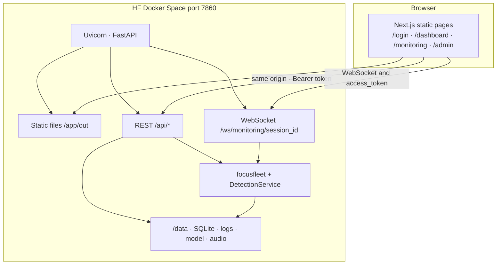
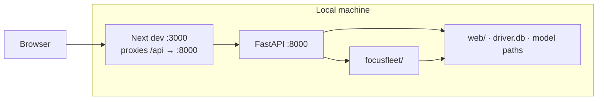
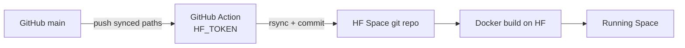
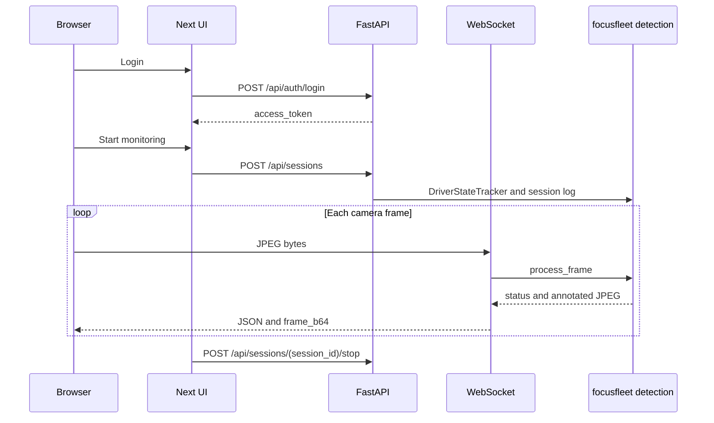
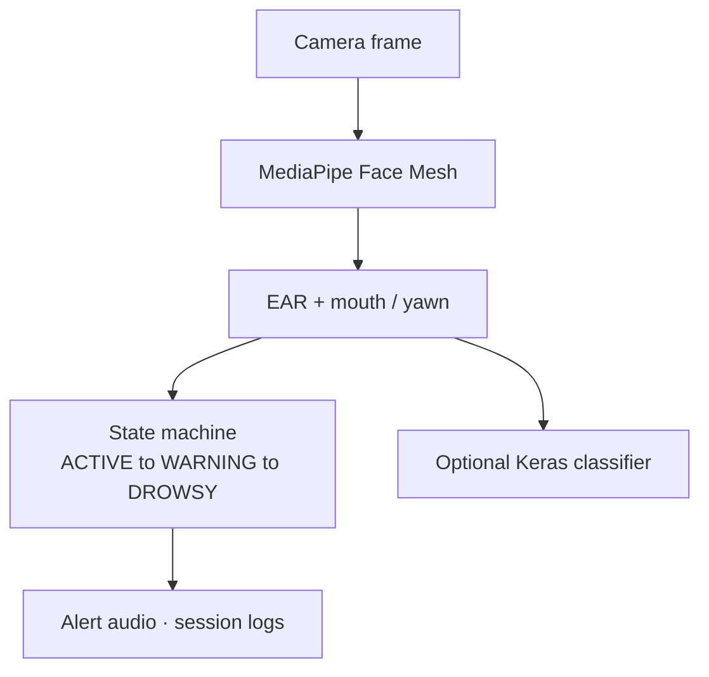

# FocusFleet architecture

High-level layout of the monorepo. Commands and deploy steps: [README](../README.md). Space env vars: [web/README-DOCKER.md](../web/README-DOCKER.md).

---

## Diagrams for reading (plain text)

These render in any editor, GitHub, and the Space README—no Mermaid plugin needed.

### A. Hugging Face Space (production)

```
                         USER BROWSER
              (login, dashboard, monitoring, admin)
                              │
                              │  HTTPS · one origin
                              ▼
┏━━━━━━━━━━━━━━━━━━━━━━━━━━━━━━━━━━━━━━━━━━━━━━━━━━━━━━━━━━━━━┓
┃  DOCKER SPACE · port 7860                                      ┃
┃                                                                ┃
┃   ┌──────────────────┐         ┌──────────────────────────┐   ┃
┃   │ Next.js static   │  HTTP   │ FastAPI                   │   ┃
┃   │ pages + assets   │◄───────►│ REST  /api/*              │   ┃
┃   │ /app/out         │         │ WS    /ws/monitoring/…    │   ┃
┃   └──────────────────┘         └─────────────┬────────────┘   ┃
┃                                              │                 ┃
┃                                              ▼                 ┃
┃                               ┌──────────────────────────┐   ┃
┃                               │ focusfleet               │   ┃
┃                               │ face mesh · EAR · states │   ┃
┃                               │ optional Keras · alerts  │   ┃
┃                               └─────────────┬────────────┘   ┃
┃                                              │                 ┃
┃                                              ▼                 ┃
┃                               FOCUSFLEET_DATA_DIR (/data)      ┃
┃                               driver.db · logs · model · mp3   ┃
┗━━━━━━━━━━━━━━━━━━━━━━━━━━━━━━━━━━━━━━━━━━━━━━━━━━━━━━━━━━━━━┛

Auth: POST /api/auth/login → access_token (browser storage + Authorization header)
```

### B. Local development

```
  Browser ──► Next.js dev server (:3000)
                    │
                    │  /api/* proxied in dev
                    ▼
              FastAPI (:8000)
                    │
                    ├──► focusfleet/  (detection code)
                    └──► web/         (DB + model paths on disk)
```

### C. Code → Hugging Face

```
  GitHub (main)  ──push──►  GitHub Actions + HF_TOKEN
                                    │
                                    ▼
                          HF Space git repository
                                    │
                                    ▼
                          Docker build → Running app
```

### D. Monitoring session (driver)

```
  1. Login (token stored)
  2. POST /api/sessions          → start log + tracker
  3. WebSocket: send camera JPEG → detect → JSON + annotated frame back
  4. POST /api/sessions/{id}/stop → finalize session_log.txt
  5. Dashboard / analytics read logs under /data/logs/{name}/
```

---

## Mermaid versions (GitHub preview)

### 1. Production (Hugging Face Docker Space)

One container on port **7860**: static Next.js UI and FastAPI share the same origin.



| Piece | Path / note |
| --- | --- |
| Image build | `Dockerfile`: `npm run build` → `frontend/out` → `/app/out` |
| Start | `docker-entrypoint.sh`: seed assets → `FOCUSFLEET_DATA_DIR=/data` → Uvicorn |
| Auth | Login returns `access_token` (localStorage + `Authorization` header); cookies optional |
| Admin | Space secrets `FOCUSFLEET_ADMIN_*` → upsert admin user on startup |

---

## 2. Local development

Two processes (or three with Gradio-only CV testing):



Optional: `web/main.py` (Gradio) talks to `focusfleet/` directly without the Next stack.

---

## 3. GitHub → Hugging Face sync



Synced: `focusfleet/`, `backend/`, `frontend/`, `Dockerfile`, `docker-entrypoint.sh`, runtime assets.  
Not synced: local logs, `.venv`, `node_modules`, `.env.local`.

---

## 4. Live monitoring (product path)



---

## 5. Detection pipeline (shared)



Implementation: `focusfleet/detection.py`, `focusfleet/state.py`, `focusfleet/session_logger.py`, `backend/app/services/detection_service.py`.

---

## Repo map

| Directory | Role |
| --- | --- |
| `frontend/` | Next.js static UI |
| `backend/` | FastAPI app (`app/main.py`, routers, WebSocket) |
| `focusfleet/` | Shared CV, config, session logging |
| `web/` | Gradio entry for local CV tests; source for Space README frontmatter |
| `application/` | Legacy desktop app |
| `scripts/` | `sync-huggingface-space.sh` |
