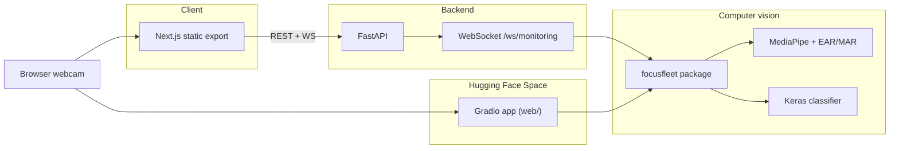

# FocusFleet architecture

High-level layout of the monorepo. See the root [README](../README.md) for local dev commands and deployment notes.

| Layer | Role |
| --- | --- |
| `frontend/` | Static Next.js UI (dashboard, monitoring, analytics, settings). Talks to the API when `NEXT_PUBLIC_USE_MOCK=false`. |
| `backend/` | FastAPI: auth, sessions, analytics, live monitoring over WebSocket. Uses `web/` as working directory for DB and model paths. |
| `focusfleet/` | Shared CV, state machine, session logging, and Gradio UI wiring. |
| `web/` | HF Space entrypoint (`app.py` / `main.py`); synced to the Space repo via CI or `scripts/sync-huggingface-space.sh`. |
| `application/` | Legacy CustomTkinter desktop app (optional local install). |
